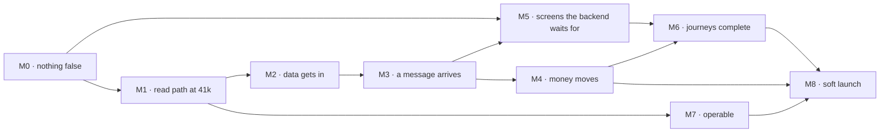

# The production build plan — from here to 41,000 listings

**Written against `7527e706` (#241), revised 9 November 2026** to cover both November packages —
the 102-board main canvas and the 28-board services canvas, **130 boards**. Takes the findings in
`docs/screen-set-gap-analysis.md` and sequences them into fourteen one-week sprints across nine
milestones. Every task carries its gap-register id (`G1`–`G50` goods, `S1`–`S22` services), its
file anchor, and a size. Design work is referenced by its prompt id (`P-01`–`P-66`) in
`docs/design-prompt-book.md`.

This plan **does not** replace `docs/build-plan.md` or `docs/services-build-plan.md`. Those two
sequenced 72 boards and all but seven of them landed. This one starts from the November handoffs
and from one goal those two documents never had: **put 41,000 scraped businesses into production.**

Read `docs/screen-set-gap-analysis.md` §4 first. **Twenty-five decisions** there gate work in
here, and four of them gate a whole milestone: N9 (the invoice issuer and its TRN) gates M4, N16
(the fee-basis set) gates the services half of M5, N18 (the `6a-s` rollout policy) gates 1,267
landing pages, and N19 (the area weight) decides whether the product rewards over-claimed coverage.

**One correction to the first revision of this plan:** task T12.2 asked for `/onboarding/kind` to
be built to a new board. Board `2b-s` already is that board, so T12.2 is deleted and prompt P-19 is
withdrawn. The error came from reading the goods package without the services canvas.

---

## 1 · The ordering principle

`docs/build-plan.md` ordered by *what is live and wrong, before what is live and thin, before what
does not exist yet*. That principle still holds and it is not sufficient any more, because the goal
changed. At 430 seeded businesses every screen in this product works. At 41,000 three of them
stop telling the truth and one of them cannot be loaded at all.

So the order is:

> **What is false on a live page, before what cannot scale, before what cannot take money, before
> what has no screen, before what has no drawing.**

Honesty defects come first because they are small, they are all in `lib/i18n/en.ts` or one line of
a page file, and every one of them is a sentence a real buyer or a real seller reads. Scale comes
second because it is the only category of work in this plan that gets **harder** the longer you
wait — pagination, the sitemap and the import path all have to land before the data does, not
after.

### What this plan deliberately does not do

- **It does not re-open the storefront builder.** Decision N1. **Nine** boards retired — 5a–5h
  from the goods canvas and `5c-s` from the services one, which shipped on 13 Sep and was cut with
  the builder two days later.
- **It does not build 12j.** Approved decision: no resend control.
- **It does not build `6g-s`.** Cut 14 Sep, unbuilt, despite the services package calling it *"the
  most urgent gap in the track"*. It returns as a CI change and a table column — T1.24 and P-62.
- **It does not build the attribute dictionary.** D3 answered *no* on 9 Sep 2026.
- **It does not add SMS.** Decision N10 recommends retiring the channel; the work is removing two
  promises, not adding a carrier.
- **It does not add a services availability enum.** D11 was closed as *no* on 11 Sep. Four
  services renders still draw one; P-54 retracts them.
- **It does not build `1c-s` as a separate screen.** It is `10c-s` — one route, one loader.
- **It does not redesign anything that works.** Roughly **forty** renders across the two packages
  are older than the code. §2 of the gap analysis lists them; each gets a ruling, not a sprint.

---

## 2 · The architecture, as it is

Not a proposal. This is what `7527e706` contains, written down because the handoff's Task 2 brief
assumes a greenfield and there is nothing green about it.

| Layer | What it is | Where |
|---|---|---|
| Framework | Next.js App Router, TypeScript strict, React Server Components | `app/` — 168 page routes, 735 files |
| Surfaces | four route groups: `(public)`, `(dashboard)`, `(admin)`, `(onboarding)`, plus `(auth)` and `/dev` | `app/(…)/` |
| Tenancy | single database, single app. A seller's own address is a **subdomain label under our zone**, rewritten by the proxy — not a per-seller deployment | `proxy.ts`, `/dashboard/domain` |
| Data | Postgres on Supabase via Prisma, 156 models, 158 migrations. RLS on with **zero policies** — deliberate; all access is through Prisma as the service role | `prisma/schema.prisma`, `docs/database.md` |
| Domain services | 972 files. Every staff write passes one fence | `lib/`, `lib/audit/staff-mutation.ts:102` |
| Capabilities | one function per capability, role as an input and never the check | `lib/auth/capabilities.ts`, `lib/auth/guards.ts` |
| Components | 113 primitives and domain components. **No component library** — the primitives are ours | `components/` |
| Design tokens | 228 CSS variables; `docs/tokens.css` is byte-identical to the handoff's `shared/foundation/tokens.css` | `app/globals.css` |
| Localisation | every user-visible string through `t()`; 12,577 keys | `lib/i18n/en.ts` |
| Search and ranking | a weights vector per query shape, keyed by business kind, with a save/preview/publish path | `lib/search/`, `/admin/search` |
| Jobs | two Vercel crons — `/api/jobs/daily` (24 steps), `/api/jobs/sweep` (5) — with a run record per step | `vercel.json`, `app/api/jobs/` |
| Notifications | four channels (email via Resend, WhatsApp via Bird, SMS with **no carrier**, in-app), templates held in the database with versions and Meta state | `lib/notify/` |
| Billing | plans, entitlement snapshots, subscriptions, renewals, dunning, invoices, credits, placement — all real, with **no payment provider bound** | `lib/billing/` |
| Media | Supabase Storage, one file many products, with a private-document fence | `lib/media/` |
| Maps | MapLibre with a worker copied at predev/prebuild | `scripts/copy-map-worker.mts` |
| Gates | `verify:fast` (typecheck, lint, 9 scans, unit) and `verify` (+ integration + build) | `package.json` |
| CI | one `verify` job and a sharded `acceptance` job, each with its own `supabase start` | `.github/workflows/ci.yml` |
| Tests | 335 files · 94 Playwright specs · 58 gallery states at `/dev/gallery` | `tests/` |

**What is not in the repository**, and cannot be fixed by a commit: a payment gateway and its
merchant onboarding; a UAE entity with a TRN; Meta's approval of the WhatsApp authentication
template and the fifteen notice templates; the Bird channel id; Supabase's phone provider switched
on; an SMTP sender; wildcard DNS for `*.businesslistings.me` plus that wildcard on the Vercel
project; a Search Console connection; an error tracker; a documented restore drill; and the
production data corrections in `docs/design-exports.md` §13i.

---

## 3 · Milestones

| M | Name | Sprints | Exit gate |
|---|---|---|---|
| **M0** | Nothing on a live page is false | S1 | every string in §4's task list corrected; `check:audit` in CI |
| **M1** | The read path holds at 41,000 | S2–S3 | ranking and paging in SQL; sitemap index; a seeded 41,000-row database renders every template under budget |
| **M2** | The data gets in | S4–S5 | 41,000 real records staged, deduped, categorised and published from the console |
| **M3** | A message reaches a person | S6–S7 | every emitted event has a live template on a working channel, and an imported business receives on the platform floor |
| **M4** | Money moves | S8–S9 | a card is charged, a compliant UAE tax invoice is issued, dunning sends, cancellation dates are right |
| **M5** | The screens the backend waits for | S10–S11 | 3n, 1o, 7h, 7g, 3m's rail, 12i and 12g's grid shipped |
| **M6** | Every journey completes | S12 | a goods seller, a service firm and a firm that does both each go claim → kind fork → live → quote or proposal → accepted, on a phone |
| **M7** | It can be operated | S13 | error tracking, alerting, a restore drill, rate limits, the runbooks |
| **M8** | Soft launch | S14 | one emirate, one sector, real buyers, measured |

**Critical path:** M0 → M1 → M2 → M3 → M4. M5 and M6 can start as soon as the matching design
prompt returns and run in parallel with M3/M4 by a different hand. M7 should start in S2 and
finish in S13 — it is not a sprint's worth of work in one place.

---

## 4 · M0 · Nothing on a live page is false

**Sprint S1. One PR, one deploy** — every task here is a string or a line, and the batching rule
says they land together.

| # | Task | Gap | Anchor | Size |
|---|---|---|---|---|
| T1.1 | Rewrite `home.trust_3`. The homepage cold-start panel sells a verification tier cut on 5 Sep | G1 | `lib/i18n/en.ts:4070` → `components/domain/RfqPanel.tsx:153` | S |
| T1.2 | Rewrite `compare_quotes.cheapest.one_supplier` — "You accept one supplier per enquiry" is false since `8815989` | G7 | `lib/i18n/en.ts:5207` | S |
| T1.3 | Print `displayName` on a claimed claim-result row; keep `tradeName` on an unclaimed one | G6 | `ClaimResults.tsx:147`, reading `claim.ts:138` | S |
| T1.4 | Remove "the CSV importer is not built yet" — 11d shipped | G9 | `dashboard/templates/[slug]/page.tsx:233` | S |
| T1.5 | Remove "board 12d is not built" — `lib/crm/derive.ts:202` consumes those rows | G10 | 6f's footer string | S |
| T1.6 | Remove the SMS promise from 1h and 1i (decision N10) | G21 | `lib/i18n/en.ts` | S |
| T1.7 | `UPDATE` the `verification_policy` LegalPage row to the three-rung text; move `effective_from` to the day it is corrected | G4 | production data, not a deploy | S |
| T1.8 | Rewrite the review policy in the seed on all five points, then `UPDATE` the row | G5 | `prisma/seed-campaign-legal.mts` | S |
| T1.9 | Correct the guide bylines to the ratified editor (D6) | — | `/admin/content/guides/:id` | S |
| T1.10 | Add `pnpm check:audit` to CI | G34 | `.github/workflows/ci.yml` after line 97 | S |
| T1.11 | Gate `/admin/businesses` and its 22-column CSV export on a capability; match `/admin/leads` | G36 | — | S |
| T1.12 | Replace all seven `throw new Error` in the spec library with a returned refusal through `t()`; delete the 13 untranslated English strings | G37 | `admin/spec-library/actions.ts:37-176`, `lib/spec/versions.ts` | S |
| T1.13 | Close an expired view-as session inside the start transaction (`endedAt = expiresAt`); add the test that starts after a natural expiry | G38 | `lib/support/view-as.ts` | S |
| T1.14 | Make 4h's chip nav a partition — move the three toggles outside the type `<nav>`, as 4b already does; drop the label filter from the e2e | G49 | `admin-reports.spec.ts:44` | S |
| T1.15 | Fix the Free setup deadlock: the team task targets the plan's seat allowance (decision taken in P-22) | G40 | `lib/setup/tasks.ts:139`, `:279` | S |
| T1.16 | Make 12f's "sessions in the last while" a count with a stated window; give the reason field its own hint; route `startViewAs`'s English through `t()`; add *Stop looking* to the dashboard strip | — | `docs/design-exports.md` §12f | M |
| T1.17 | Extend `check:tokens` to catch untranslated strings in `.ts` service modules, not only JSX in `.tsx` | G37 | `scripts/check-tokens.sh:32` | M |

**Services, same sprint, same PR.** Every one of these is a string or a line, and four of them are
sentences a practice reads in the first ten minutes of its life on the platform.

| # | Task | Gap | Anchor | Size |
|---|---|---|---|---|
| T1.18 | **Pass the kind to the onboarding strength meter.** A tax practice is currently measured on the goods weight table: it reads *"Add your first products"* and *"Fill in product specifications"* in its own meter, caps at 65, and sees a different number on `/dashboard/setup` — while the file loads every services fact at the cost of five queries and discards them | **S7** | `lib/onboarding/profile.ts:158-159`; `weightsFor(kind)` already exists at `lib/metrics/profile-strength.ts:185` | S |
| T1.19 | Fix the Free setup deadlock in the **services** task set too. `SERVICES_TARGETS` overrides only `photos`, so `team: 2` governs a practice and its ceiling is **72**, not the goods case's 90 | **S10** | `lib/setup/tasks.ts:139`, `:162` | S |
| T1.20 | Rewrite `kind.cost_body`. It tells a seller switching kind that it *"rewrites your catalogue — nothing carries across"*, while `kind.settings_keeps` says *"Nothing you have entered is converted or deleted."* The second is what the code does (decision N21) | **S1** | `lib/i18n/en.ts:9432`, `:9443` | S |
| T1.21 | Either make something re-ask when the declared kind and the chosen trades disagree, or stop promising it. The screen says *"we will ask again rather than quietly override you"* and no reader exists (decision N22, design P-53) | **S2** | `lib/i18n/en.ts:9433` | S + design |
| T1.22 | Stop telling sellers certificates *"can be shown on your storefront"*. Since the builder cut they render on no public surface | **S3** | `/dashboard/verification` | S |
| T1.23 | Branch `seo.business_description` on kind. It currently promises a services firm's *"branches and catalogue"* in its meta description | **S4** | `app/(public)/b/[slug]/page.tsx:130` | S |
| T1.24 | Extend `check:vocabulary` to read `string_entry` as well as `lib/i18n/en.ts`, so a string held in the paired registry is visible to CI. **This is the structural half of the cut `6g-s`** | **S13** | `scripts/check-vocabulary.sh:10` | S |
| T1.25 | Fix the two leaked goods words that reach service firms: `services.eyebrow` reads *Catalogue* and `coverage_step.group_branches` reads *"Where your stock sits"* | **S5** | `lib/i18n/en.ts` | S |
| T1.26 | Delete the two orphan `service_public.compare_*` strings, which describe a surface that does not exist (`1g-s` B9) — or build it, per P-60. Recommendation: delete | **S6** | `lib/i18n/en.ts` | S |
| T1.27 | Put `refetchRegister` through the fence, or document the exemption in `check:audit`'s list with a written reason as the other fifteen are | **S12** | `lib/credentials/review.ts:251-262` | S |
| T1.28 | Widen `/admin/spec-library` to `taxonomy.read` for a moderator, as `/admin/categories` already was, or state why the same seat gets two answers | **S14** | — | S |

**Exit gate.** `pnpm verify` green with `check:audit` now in CI and `check:vocabulary` now reading
the registry. A `rg` over `lib/i18n/en.ts` for the cut tier, the single-supplier rule, the two "not
built yet" sentences and the two contradictory kind-switch strings returns nothing. The two
LegalPage rows read correctly on production. A moderator cannot open `/admin/businesses`' export
and can open the spec library read-only. A staff member can start a view-as session after letting
one expire. **A seeded practice completes setup on Free and its meter names services work.**

---

## 5 · M1 · The read path holds at 41,000

**Sprints S2–S3.** This is the milestone that gets harder if deferred, because every one of these
defects is invisible at 430 rows and unavoidable at 41,000.

### S2 · Ranking and paging into SQL

| # | Task | Gap | Anchor | Size |
|---|---|---|---|---|
| T2.1 | Build the seed-at-scale harness first: a script that generates 41,000 businesses with a realistic category, emirate, area, tier and product distribution. **Nothing else in this milestone can be verified without it** | — | new, beside `prisma/seed.mts` | M |
| T2.2 | Move the blended ranking score into a SQL expression and page with `ORDER BY score, id` + `LIMIT/OFFSET`. Today: `take: 200` with no `orderBy`, ranked in Node, sliced for the page, against a page count from a real `count()` | G27 | `lib/db/queries/search.ts:646-656`, `:737`, `:1011` | L |
| T2.3 | Extend `check:ordering` to fire on a read that has **no** `orderBy` and a `take`, which is the shape it currently cannot see | G27 | `scripts/check-ordering.mts:17` | S |
| T2.4 | Remove `MAX_LISTINGS = 20_000` by ranking in SQL, or shard the nightly position snapshot by category. The admin ranking preview runs the same load on a page request | G31 | `lib/search/directory.ts:138`, `lib/analytics/snapshot-job.ts:119`, `lib/search/impact.ts:205` | L |
| T2.5 | Add the composite indexes the new SQL ranking needs, as hand-written idempotent migrations (the project's rule — `migrate dev` drops them otherwise) | — | `prisma/migrations/` | M |
| T2.6 | One predicate for "suppliers in this trade" (decision N14): `landingFacts` takes `businessWhere`'s category clause, so the three counts above a list stop disagreeing with the list | G— / 10a | `lib/seo/facts.ts`, `lib/seo/taxonomy.ts`, `lib/db/queries/search.ts` | M |

### S3 · Rendering, the index, and the crawl surface

| # | Task | Gap | Anchor | Size |
|---|---|---|---|---|
| T3.1 | Split the sitemap with `generateSitemaps()` into an index, chunked by class and id range | G28 | `app/sitemap.ts` | M |
| T3.2 | Separate the cacheable shell from the `searchParams`-dependent body on `/b/[slug]`, `/c/*` and `/[emirate]/[area]*`, so `revalidate` stops being inert on the three highest-traffic template classes | G30 | those route files | L |
| T3.3 | Audit the crawl surface at 41,000: `robots.txt`, `noindex` on filtered views, canonical targets, and the publish floor. Confirm the facet-combination trap is closed on the real taxonomy, not the seed's | — | `app/robots.ts`, `lib/seo/` | M |
| T3.4 | Fix 10a's zero-state Browse link, which builds `/c/{sub}` and 404s; the same defect exists in `/lp/:campaign`'s call to action | G— | `lib/seo/`, `lp/[campaign]/page.tsx` | S |
| T3.5 | Enforce 6b's five-member curated-list floor where the comment already argues for it | G— | `best/[slug]/page.tsx:94`, `criteria.ts:34` | S |
| T3.6 | Record impressions on the goods landing page, as the services twin already does, with a `source` discriminator on the impression row so landing views count toward *how often you were seen* without polluting *what buyers searched* | G47 | `app/(public)/_landing/LandingPage.tsx`, `search_impression_day` | M + migration |
| T3.7 | Page Supabase auth users properly — above 4,000 users a phone number silently loses the ability to send an enquiry | G32 | `lib/auth/flow.ts:830` | M |
| T3.8 | **Build the `6a-s` rollout control** (design P-56, decision N18). The services landing class is ~**1,267** addressable URLs, **zero live**, with a nullable column as the only brake and no rule for opening a trade. The repo's own doc understates it as *"roughly doubles the matrix"*; it is about fourteen times | **S17** | `prisma/schema.prisma:996`, `/admin/content/matrix` | M |
| T3.9 | Say on screen that work sold by the job is not in a bounded or wordless result set, with a link to the same query unbounded. Both routings are deliberate and documented; the buyer is simply never told | **S—** | `lib/search/blended.ts:908`, `:913` | S |

**Exit gate.** Against a 41,000-row database: every public template renders inside the performance
budget; the pager's last page serves rows; `?page=` deep in a large shelf returns a defensible
ranking; the sitemap index validates and every chunk is under 50,000 URLs; a cold request to
`/b/:slug` is served from cache; the nightly snapshot ranks every published listing; and `3l`'s
funnel stage 1 sums to its own breakdown.

---

## 6 · M2 · The data gets in

**Sprints S4–S5.** Design input: **P-37**.

### S4 · A transport that can carry the file

| # | Task | Gap | Anchor | Size |
|---|---|---|---|---|
| T4.1 | Replace the form-post stage with an object-storage upload: the browser puts the file in Storage, the server stages from there. The current ceiling is a 4 MB body against a declared 50,000-row limit, and a 40,000-row licence export is 6–10 MB | G29 | `next.config.ts:13`, `admin/ingest/StageForm.tsx:30`, `lib/ingest/service.ts:155` | L |
| T4.2 | Chunk staging and publish into per-chunk transactions with a resumable cursor. Both currently run the whole file in one 120 s interactive transaction, on a pooler the app opens with `connection_limit=1`, with no `maxDuration` declared anywhere on the path | G29 | `lib/ingest/service.ts:483`, `:831` | L |
| T4.3 | Resolve slug collisions on the database's unique constraint with a retry, instead of pre-reading every slug in the directory | G29 | `lib/ingest/service.ts:650` | M |
| T4.4 | Build the dedupe match index from an indexed query per chunk instead of loading every business with all of its locations into memory, twice per run | G29 | `lib/dedupe/source.ts:44` | L |
| T4.5 | Raise or remove `MAX_BLOCK = 200`, which silently stops name-token matching as the directory grows — exactly when dedupe matters most | G— | `lib/dedupe/match.ts:29`, `:96` | M |
| T4.6 | Declare `maxDuration` on every ingest route and action | G29 | — | S |

### S5 · The real import, and what comes out of it

| # | Task | Gap | Anchor | Size |
|---|---|---|---|---|
| T5.1 | Map the 40,000-record source to the staging columns. Decide per field what is authoritative, what is derived and what is discarded. **This is the task most likely to be underestimated** — the licence export's activity text is what drives categorisation | — | new, documented | L |
| T5.2 | Categorise at scale. Rows staged `needs_category` are terminal unless something assigns one; at 40,000 rows manual assignment is not a plan | — | `/admin/ingest/categorise` | L |
| T5.3 | Dry-run the import against a copy: stage, dedupe, categorise, review the rejects, publish, roll back. Measure each step | — | — | M |
| T5.4 | Import for real, one authority at a time, publishing per batch rather than per file. Record counts per batch and reconcile the three stat cards against them | — | — | M |
| T5.5 | Seed a `NotificationPreference` row per imported business **or** land T6.1 first. Without one of the two, every imported business is deaf on every channel | G15 | `lib/notify/service.ts:103` | S |
| T5.6 | Backfill area pins, which gate distance sort | — | — | M |
| T5.7 | Re-run the publish floors and confirm which area × category pages cross them. At a 60-listing floor and 30% verified, expect far fewer live landing pages than the taxonomy allows — **and the floor also needs 250 words of unique intro copy and four FAQ rows per page, so the SEO surface is bounded by what ops can write, not by the data** | — | `/admin/content/matrix` | M |
| T5.8 | **Guess the trade kind at import, and never silently assign it.** The licence activity code is how `Category.tradeKind` gets resolved for 41,000 rows, and the product's own rule is that a business confirms its own `SellsKind` on `2b-s` rather than inheriting a guess. Decide what an unclaimed imported listing renders as before it has ever been claimed — today every services category is unopened, so a services listing imported now has no landing page to appear on | **S—** | `lib/ingest/`, `prisma/trade-kinds.mts` | M |
| T5.9 | **Seed the services ranking vector and publish it.** No row exists, so nothing has ever been published — and in the meantime a services firm is ranked on the goods vector, where its null spec completeness scores as *half*, six of twelve points, stuck, for a field that cannot apply to it. Needs P-57's publish-moment design and the attribution warning | **S9** | `lib/search/ranking.ts:417-420`; the gate at `lib/search/settings.ts:641-651` returns `[]`, so nothing is refused | M |

**Exit gate.** 41,000 records staged, deduped, categorised and published from the console with no
hand-written SQL. Rejects exported and triaged. One batch rolled back and restored cleanly.
`/admin/ingest`'s three stat cards reconcile against the batch. Every published business has a
notification preference. The page matrix shows the real number of live landing pages, and that
number is written down.

---

## 7 · M3 · A message reaches a person

**Sprints S6–S7.** Design input: **P-04**, **P-08**, **P-09**, **P-10**. This milestone implements
all four phases of `docs/plan-notification-delivery.md`, which has been *planned, not built* since
9 Sep.

### S6 · The engine

| # | Task | Gap | Anchor | Size |
|---|---|---|---|---|
| T6.1 | `DEFAULT_ROUTING`. A business with no stored preference must receive on the platform floor instead of nothing. Today `notify()` returns `[]` and `PLATFORM_FLOOR` is never reached — and no delivery row records the silence, so it is invisible in the log and in 12g | G15 | `lib/notify/service.ts:103`, `lib/notify/routing.ts:67` | M |
| T6.2 | Add `payment_failed` and `payment_final_notice` to the enum, declare their parameters, and wire the dunning job's `send` branch, which currently advances the stage and sends nothing | G16 | `lib/billing/dunning-job.ts:177` | M + migration |
| T6.3 | Store the rendered message — subject, body, action label, action url — on **every** delivery, not only deferred ones. Nothing stores the text of a sent in-app notice, so 7g has nothing to render | G19 | `lib/notify/service.ts` `record()`, `senders/in-app.ts` | M + migration |
| T6.4 | Add `readAt` to `notification_delivery` | G19 | — | S |
| T6.5 | Fix 7e's save: persist every seller event, not only the rows the screen renders. Today Save deletes routing for the eight events it omits | G17 | `/dashboard/settings` save path | M |
| T6.6 | Loop `deliverQueued()` under a time budget the way `flushDeferred` is already looped, and add an `orderBy` to the claim. The hourly ceiling on handing a message to a carrier is 200 while the step above it releases 5,000 | G20 | `app/api/jobs/sweep/route.ts:91-111`, `lib/notify/service.ts:522`, `:658` | S |
| T6.7 | A build check that fails when an emitted event has no live template on a default-route channel | — | `scripts/` | M |
| T6.8 | Retire SMS (N10): remove the two live SMS templates, the channel from the matrix, and the promise from 1h and 1i | G21 | — | S |

### S7 · The screens and the provisioning

| # | Task | Gap | Anchor | Size |
|---|---|---|---|---|
| T7.1 | Build 12g's coverage grid and the write-first-version panel from **P-08**. Until this exists an event with no template has no way in, which is the one gap that silences a notification | G18 | `/admin/notifications` | L |
| T7.2 | Rebuild 7e at 18 rows in six groups from **P-09**, with the `Default` tag, the *Not sent yet* caption, the sticky save bar and the sticky event column at 375px | G— | `/dashboard/settings` | L |
| T7.3 | Author the fifteen missing templates through the console, from **P-10**'s drafts. Content, not a commit | — | `/admin/notifications` | M |
| T7.4 | Fix `/dev/notifications` to read `sampleParams` rather than its own 22-key map — 25 of 41 placeholders currently print raw — and show live rows only, labelled by kind. Or retire it in favour of 12g's preview, which is the recommendation | G— | `app/dev/notifications/page.tsx` | M |
| T7.5 | **Outside the repo:** Resend domain and sender verified; Supabase phone provider on with the hook registered; Bird channel id set; Meta approval for the authentication template and the fifteen notice templates submitted | G39 | `docs/auth-whatsapp-otp.md:145-158` | weeks |
| T7.6 | Decide and act on 7f's four event-less specimens (P-10): make them real events, or redraw from the 16 that exist | G— | — | M |

**Exit gate.** Every emitted event has a live template on at least one working channel, asserted by
the build check. A freshly imported business receives a lead alert on the platform floor. A seller
with no saved preference receives. 7e saves 18 rows and reloading keeps every one. A password reset
and a phone OTP both reach a real person. `12g`'s meta line reads *"Every emitted event has a live
template."*

---

## 8 · M4 · Money moves

**Sprints S8–S9.** Design input: **P-11**, **P-12**, **P-05**, **P-06**, **P-07**.
**Blocked on decision N9** — who issues the invoice, under what TRN. Nothing in this milestone can
start before that is answered, and the answer involves a company registration.

### S8 · The provider and the document

| # | Task | Gap | Anchor | Size |
|---|---|---|---|---|
| T8.1 | Implement `PaymentProvider` against a UAE-capable gateway, and call `setPaymentProvider`, which has no caller today | G22 | `lib/billing/provider.ts:54`, `:77`, `:80` | L |
| T8.2 | Add a webhook route with signature verification and idempotency keys; reconcile `providerRef` against the invoice. `app/api` has no webhook directory | G22 | new `app/api/billing/webhook/` | L |
| T8.3 | Build card capture from **P-11**, provider-hosted so card data never reaches our server | G22 | new route | L |
| T8.4 | Make the tax invoice a UAE tax invoice: issuer TRN, place of supply, VAT treatment. Today the issuing entity is registered in Delaware and holds no TRN, so the document renders a recipient TRN and no supplier TRN | G23 | `lib/billing/tax-invoice.ts:43` | S in code |
| T8.5 | Make `changePlan` check `provider.live` as both jobs do. Today an upgrade issues a paid invoice with a stored PDF for money nobody took, while the screen says "No card has been charged" | G24 | `lib/billing/service.ts:325` | S |

### S9 · The sequence, end to end

| # | Task | Gap | Anchor | Size |
|---|---|---|---|---|
| T9.1 | Fix past-due cancellation: date from the drop date, not from a `renewsAt` a failed renewal never advanced, and stop writing `status: "active"` over `past_due` while the dunning stage stays set | G25 | `lib/billing/cancellation.ts:478`, `:494` | M |
| T9.2 | Build 3m's five-step failed-payment rail from **P-05**, with the delivery result per step | G— | `/dashboard/billing` | L |
| T9.3 | Build 11h and 11j's past-due states from **P-06**, on one date across all three screens | G— | — | M |
| T9.4 | Build 12i's `Last notice` column and expandable sequence from **P-07** | G— | `/admin/dunning` | L |
| T9.5 | Rebuild 1l and 2e's cards and comparison from the plan table (**P-12**); strike the Lead-response-SLA row, which sells a trust signal | G2 | `/pricing`, `/onboarding/plan` | M |
| T9.6 | A storage chooser on downgrade, or storage comes off the grid. Products, branches and seats each have one; storage has a stated overage and no chooser, so the limit is unenforced at the one moment it bites | G— | `billing/change/keep/[kind]` | M |
| T9.7 | E2E the money path: subscribe, renew, fail, dun, pay, change plan, cancel, close. **It has no coverage today beyond page loads** | G26 | `tests/e2e/` | L |

**Exit gate.** A real card is charged on a test merchant account. The invoice is a compliant UAE
tax invoice with the issuer's TRN. A failed renewal walks all five dunning steps and a delivery
row exists for each. A past-due seller cancelling sees one date, in the future, on all three
screens. Every price and every cap on `/pricing` traces to the plan table. The e2e covers it.

---

## 9 · M5 · The screens the backend is waiting for

**Sprints S10–S11.** Design input: **P-01**, **P-02**, **P-03**, **P-04**.

| # | Task | Gap | Anchor | Size |
|---|---|---|---|---|
| T10.1 | Build 3n's opt-in from **P-01**. One control. It turns on a trigger, a service, three migrations and 490 lines of integration test that have never run in production | G11 | `app/(dashboard)/dashboard/leads/actions.ts:133` | M |
| T10.2 | Build 1o's selection screen from **P-02**, including the six refusal sentences, of which **zero** exist today | G12 | `/enquiry/:id/compare` | L |
| T10.3 | Make `comparison.ts` respect `allowsPartial` so 1n's cheapest-split figure can no longer be a number the accept API refuses | G— | `lib/quote/comparison.ts:446` vs `lib/quote/split.ts:264` | M |
| T10.4 | Build 7h's split card from **P-03**, and make the 7b approval dialog consult `card.split` — today a split request is approvable under a dialog naming one supplier and one total that supplier never quoted | G13 | `lib/buyer-company/request-words.ts:153`, `lib/buyer-company/queue.ts:381` | M |
| T11.1 | Build 7g from **P-04**: the bell, the popover and the page | G14 | new `/dashboard/notifications` | L |
| T11.2 | Build the loading system from **P-13**: a `Skeleton` primitive and a `loading.tsx` per surface family. There is none in 168 routes | G43 | `components/`, `app/**/loading.tsx` | L |
| T11.3 | Build the error states from **P-14**: `error.tsx` per route group, plus the panel-level error | G44 | `app/(…)/error.tsx` | M |
| T11.4 | Build permission-denied from **P-15**, one treatment per case, replacing the three incompatible ones shipping today | G— | — | M |
| T11.5 | A `/dev/gallery` story per board for the 20-odd boards that have none, including 3f, 3h, 3i, 11d, 4e, 4h and 14 of the 15 onboarding and dashboard screens — **plus `3g-s`, `3f-s` and `3c-s`, which have twenty-one documented states between them and no rendered reference, and are the three screens the other four services boards read from** (P-66) | G45, **S22** | `app/dev/gallery/_sections/` | L |
| T11.6 | **Close the fee-basis footing (decision N16).** The comparison computes four of nineteen authored bases, so for an audit, VAT or legal brief the *Over 12 months* row — the page's entire instrument — renders all-cannot. Put `unit` and `monthsPerUnit` on `ScopeSheetFeeBasis` so a staff-authored basis cannot silently become un-footable, and delete the third closure layer. Then build P-51's none-footable comparison | **S8** | `lib/quote/proposal-footing.ts:130-170`; `lib/services/service.ts:518-537`; `prisma/schema.prisma:2437` | M + migration |
| T11.7 | Stop counting an accepted proposal as a win worth AED 0 — the one place anything totals across fee bases | **S8** | `lib/placement/impact.ts:114-138` | S |

**Exit gate.** `allowsPartial` is true on a real quote in a seeded database, a buyer accepts lines
from two suppliers, a split request routes to approval and is approved on the correct figures, and
a seller reads the resulting notice in the bell. Every route group has a loading and an error
state. `/dev/gallery` covers every board's empty and loading states.

---

## 10 · M6 · Every journey completes

**Sprint S12.** Design input: **P-19** … **P-26**, **P-30**, **P-31**, **P-17**, **P-18**.

| # | Task | Gap | Anchor | Size |
|---|---|---|---|---|
| T12.1 | 10g's held enquiry from **P-24**, with `RecipientState.held`. **Do this first in the sprint** — boards 2a, 2b and 4c already print figures that depend on it, and 4c is a shipped admin screen displaying a number nothing can produce | G— | `RecipientState`, `/b/:slug` | L |
| ~~T12.2~~ | ~~`/onboarding/kind` to a new board~~ — **deleted.** Board `2b-s` is that screen; see the header. Its two copy defects are T1.20 and T1.21 | — | — | — |
| T12.3 | The **`both` body** of `/onboarding/locations` from **P-50** — the branch list *and* the coverage set, grouped, neither behind a toggle. The one-route-two-bodies choice is correct and stays; only the `both` case is undrawn | G42, **S16** | `onboarding/locations/page.tsx:34-56` | M |
| T12.4 | Kind-aware completion from **P-49**, so a practice stops reading "0 products indexed", plus the Free team card's blocked state; and 3d's services answer, or the nav row goes | G42, **S15** | `lib/setup/complete.ts:33`, `nav-config.ts:417-422` | M |
| T12.4b | The rest of **P-50**: the `both` storefront overview, which today makes no coverage statement at all and tells only the depot half of a firm that also sells annual maintenance | **S16** | `app/(public)/b/[slug]/page.tsx` | M |
| T12.5 | 3a to **P-23**, with the first-day state, once N4 and N5 are answered; and 11a's limits block and locked-analytics card from **P-30** | G— | `/dashboard` | L |
| T12.6 | Ratify one listing-health number (N4) and delete the other three tables | G41 | one module | M |
| T12.7 | 13b from **P-25**, with the reference line every `wa.me` chip is missing today | G— | new `/enquiry/:id/whatsapp` | M |
| T12.8 | 13d from **P-26**, including the 404/410 split and the resolution diagnostic, using the suggestion query written for it | G— | `app/not-found.tsx`, `lib/listing/suggestions.ts` | M |
| T12.9 | Narrow layouts from **P-17** and **P-18**. The seller reply path is the one that pays: reply speed decides ranking | G46 | — | XL |
| T12.10 | Delete saved requirements from five boards (N7), or build it | G48 | — | S or L |
| T12.11 | 13i from **P-27** on the numbered legal template; the cookie banner and settings from **P-28** | G3, G4 | — | L |
| T12.12 | The services shape of `/dashboard/verification` from **P-52**, with the certifications block from **P-39** — the one piece taken out of the cut builder, and `8ebfe9f1`'s own open question since 15 Sep. Includes the state neither canvas draws: a credential reviewed but **not** verified, which reads *On file* | **S3** | `/dashboard/verification`, `app/(public)/b/[slug]/` | M |
| T12.13 | The seller's mirror of a won proposal from **P-64**, as a state on the quotes pipeline rather than a new route — the winning supplier currently has no screen for the thing they won. Plus a neutral review dimension set, because the terminal state of the services chain currently asks *"It arrived when they said"* | **S20**, **S21** | `/dashboard/quotes`, `/review/new` | M |
| T12.14 | The area weight from **P-57** and decision N19. Three readers filter on area and none weighs it, so a seller who named Business Bay ranks level with one who ticked *anywhere in Dubai* — which teaches sellers to over-claim, and over-claimed coverage is what makes a services directory useless | **S18** | `lib/enquiry/fanout.ts:199-203`, `lib/enquiry/service-brief.ts:359-368`, `lib/search/service-signals.ts:137-158` | M |
| T12.15 | `3b-s`'s two-field practice size and the corrected band labels from **P-55** and decision N20 | — | `/dashboard/listing` | S |
| T12.16 | The completeness consequence line on `3g-s` from **P-63** — the number drives setup task 2 and search position, and the editor states neither | — | `/dashboard/services/[id]` | S |
| T12.17 | The `4c-s` name near-match state from **P-61** — the realistic contents of the credential queue and the only state a human decides | — | `/admin/queue/credential/[id]` | M |
| T12.18 | The drift column on `/admin/strings/paired` from **P-62** — the affordable remainder of the cut `6g-s`, after T1.24 does its structural half | **S13** | `/admin/strings/paired` | S |

**Exit gate.** Two scripted walkthroughs pass on a phone and on a desk: a goods seller claims,
verifies, sets up, receives an RFQ, quotes, and the buyer accepts; and a service firm does the same
through the kind fork, coverage, credentials, a scope sheet, three services, a brief and a
proposal — **including an audit or VAT brief, whose comparison must now read honestly rather than
as a row of apologies.** A third walkthrough for a firm that does both. No step renders a sentence
that is not true. Axe clean at 1280 × 720.

---

## 11 · M7 · It can be operated

**Sprint S13, started in S2.** Not one sprint's work in one place — most of it is a day here and a
day there, and it should be landing throughout.

| # | Task | Gap | Size |
|---|---|---|---|
| T13.1 | An error tracker with `onRequestError` in `instrumentation.ts`, which exports only `register()` today. The whole observability surface is 53 `console.error` sites | G35 | M |
| T13.2 | Uptime checks on `/` and both job routes; an alert on `job_run.ok = false`. The 2026-09-04 six-hour outage is the template: nobody was told, and the first signal was a person noticing | G35 | M |
| T13.3 | A written restore drill against Supabase PITR. `backup`, `restore`, `PITR`, `alert` and `uptime` return **nothing** across four ops documents | G35 | M |
| T13.4 | A rate bucket on enquiry creation, keyed on IP and on phone, plus OTP-before-send or a challenge on the signed-out path. Today it is an unauthenticated write that **mints a Supabase auth user** and fans out to 8 sellers, with no bucket in the policy list | G33 | M |
| T13.5 | Review every other unauthenticated write for the same shape | G33 | M |
| T13.6 | Ops runbooks: import a registry batch, resolve a claim conflict, handle a PDPL request, take a maintenance window, roll back a bad deploy, correct a LegalPage row | — | M |
| T13.7 | Decide N8 — drop `ApiKey` and the 12h API panel, or give it a consumer. Zero readers, zero writers, and a docblock opening *"The only way anything outside this codebase reads our data."* | G50 | S |
| T13.8 | `/admin/areas` from **P-33**; `/admin/compliance` from **P-34** once the deletion rule is reconciled with 11i and 13g | G— | L |
| T13.9 | Lighthouse and load tests on the templates that carry the traffic: search, a category shelf, an area page, a storefront | — | M |

**Exit gate.** A deliberately broken page raises an alert that reaches a person. A restore has been
performed, not just documented. A script cannot create 1,000 enquiries. Every runbook has been
walked once by someone following only the document.

---

## 12 · M8 · Soft launch

**Sprint S14.**

| # | Task |
|---|---|
| T14.1 | One emirate, one sector. Publish the area pages that clear the floor and nothing else. |
| T14.2 | Ten real suppliers claimed and verified by hand, with the ops lead watching every queue. |
| T14.3 | Buyer traffic from one channel only, so attribution is unambiguous. |
| T14.4 | Measure: enquiry-to-first-reply median (the number 7f exists to protect), claim conversion, zero-result rate, and the publish-floor crossings per week. |
| T14.5 | A week of no change, then read the numbers. Then widen by emirate, not by sector. |

**Go-live checklist.** Every item is a yes/no, and a no stops the launch.

- [ ] No live page states a fact the code contradicts (M0 exit, re-run)
- [ ] 41,000 listings published; the three ingest stat cards reconcile
- [ ] Every public template renders inside budget at full volume; the pager's last page serves rows
- [ ] Sitemap index validates; every chunk under 50,000 URLs; submitted to Search Console
- [ ] Every emitted event has a live template on a working channel
- [ ] A real person can sign in by phone and by email
- [ ] A card can be charged; the invoice is a compliant UAE tax invoice
- [ ] The dunning sequence sends, and 12i can prove it did
- [ ] A buyer can accept across suppliers; a company approval shows the right figures
- [ ] A seller reads a notice in the bell
- [ ] A practice completes setup on Free, and its meter and completion screen name services work
- [ ] An audit or VAT brief's proposal comparison reads honestly — no row of apologies, no total across bases
- [ ] The services ranking vector is seeded and published; no services firm is scored on a goods field
- [ ] Every services trade with a live landing page cleared the floor *and* has a written intro
- [ ] No services surface prints an availability word, a stock word, or a tier that was cut
- [ ] A firm that does both has one coherent storefront, one coherent setup and one coherent coverage statement
- [ ] Loading, error and permission-denied states exist on every surface
- [ ] Cookie consent exists, or the cookie page no longer claims it does
- [ ] Both legal policies agree with the code
- [ ] Error tracking and alerting live; a restore has been performed
- [ ] Enquiry creation is rate-limited
- [ ] `pnpm verify` green; CI runs all ten scans including `check:audit`
- [ ] Axe clean at 1280 × 720 on every surface family
- [ ] The cold-start pass renders honest at 40 listings per new area

---

## 13 · Non-functional requirements

| Area | Requirement | How it is enforced |
|---|---|---|
| Performance | a public template renders inside its budget at 41,000 rows; no unbounded `findMany` on a request path | the S2 harness, plus T13.9's load tests |
| Accessibility | WCAG 2.2 AA; the contrast floor in the design system; one `h1`; real tables with `scope`; live regions polite except a failed save | the sharded `acceptance` job's axe pass at 1280 × 720, plus `check:contrast` by hand when a screen moves a colour |
| Security | every staff write through the fence with a written reason; one capability function per capability; RLS on with access through Prisma only; the private-document fence; no credential or payment data touching our server | `check:audit` (now in CI), `audit:private-docs`, the capability tests |
| Privacy | PDPL: the privacy page, the cookie register, account closure, and the compliance queue must describe the same behaviour. They currently describe three | T12.11, T13.8 |
| Abuse | rate limits on every unauthenticated write; a challenge on enquiry creation; spam controls on reviews | T13.4, T13.5 |
| Observability | an error tracker with request context; a run record per job step (**already built**); alerts on job failure and on uptime | T13.1, T13.2 |
| Backups | Supabase PITR with a drill performed and written down | T13.3 |
| Deploys | additive migrations apply **before** the merge; `check:schema-deployed` fails the build when migrations are pending, so a production build with pending schema is marked ERROR and the previous deployment keeps serving | `scripts/check-schema-deployed.mts`, `docs/deployments.md` |
| Deploy cost | merge in batches, never per fix. Each deployment gets a fresh ISR cache, so every production deploy makes every non-prerendered page cold again — and at 41,000 listings that is the dominant cost line | the batching rule in `CLAUDE.md` |
| Localisation | every string through `t()`; no layout assumes LTR; Arabic is a translation project, not a rebuild | `check:tokens`, extended by T1.17 |

---

## 14 · Testing

| Layer | Today | What this plan adds |
|---|---|---|
| Unit | the `unit` Vitest project | tests for `lib/placement/` (which has **none** and holds the only path that sells anything), `dunning-queue.ts`, `invoice-delivery.ts`, `subscription-list.ts` |
| Integration | the `integration` project, against a real database | the money path (T9.7), the notification engine (T6.x), the ingest chunking (T4.x) |
| E2E | 94 Playwright specs, sharded in CI | the six cross-surface flows end to end; a goods walkthrough and a services walkthrough; the money path; mobile viewports |
| Scans | 9 `check:*` in `verify:fast`, **8 in CI** | `check:audit` into CI (T1.10); `check:ordering` extended to orderBy-less reads (T2.3); `check:tokens` extended to `.ts` modules (T1.17); a new emitted-event-without-template check (T6.7) |
| Visual | 58 gallery states | a story per board (T11.5), which is the gate the project's own checklist asks for and 20-odd boards fail |
| Load | none | search, a category shelf, an area page, a storefront, at 41,000 rows (T13.9) |

Two standing rules from the project's own experience, both worth restating because they cost real
time: **a green suite can assert the bug** — `dashboard-setup-photos.spec.ts:75` asserts a missing
field's absence, and `admin-reports.spec.ts:44` filters out the nav defect by label — so when a
test guards a gap, fix the test in the same commit as the gap. And **click it, not the diff**:
reading code is how you miss that a button does nothing.

---

## 15 · The first two weeks

**Week 1 — sprint S1, M0.** Every task in §4. One branch, one PR, one deploy, because the batching
rule says related changes land together and these are seventeen one-line corrections to things a
real user reads. Nothing here needs a design prompt, nothing here needs a decision, and nothing
here needs a provider. It is the only sprint in this plan with no external dependency, which is
exactly why it goes first.

In parallel, on day one, five things that are not code:

1. **Send P-01.** It is the smallest prompt in the book and three boards plus a complete tested
   engine are waiting behind it.
2. **Send P-54.** It is the cheapest prompt in the book — a retraction pass over four services
   renders that still draw an availability enum closed as *no* on 11 Sep and a verification tier
   cut on 5 Sep. An engineer building those boards faithfully reintroduces both.
3. **Answer N9** — who issues the invoice and under what TRN. It gates all of M4, and the answer
   involves a company registration, so the clock starts now.
4. **Answer N16** — is the fee-basis set open or closed? It gates the services track's one blocking
   screen defect, and the recommendation is a small migration rather than a redesign.
5. **Submit the Meta templates and provision Resend, Bird and the Supabase phone provider.** T7.5
   is weeks of other people's time and none of it is yours; starting it in S7 means waiting in S7.

**Send the two packages back together, with §5 of the gap analysis attached.** Twenty numbered
corrections, and the cost of not sending them is already measured: reading the goods package alone
produced a wrong finding in the first revision of this plan, because a board that exists on the
other canvas read as missing.

**Week 2 — sprint S2, M1.** T2.1 first and alone: the 41,000-row seed harness. Every other task in
M1 is unverifiable without it, and the temptation to skip it and reason about the query plans
instead is the single most expensive mistake available in this plan. Then T2.2 — ranking and paging
into SQL — which is the largest correctness defect in the codebase and the one that gets worse with
every row imported.

Also in week 2: send **P-13** and **P-14**. The loading and error systems are one design job each
and they apply to every board in the package, so they are the cheapest design work available and
they unblock M5.

---

## 16 · Risks

| Risk | Why it is real | Owner | Recommendation |
|---|---|---|---|
| **N9 is a company registration, not a decision** | no UAE entity, no TRN, so no compliant tax invoice and no gateway onboarding. M4 cannot start | you | start it in week 1; it is the longest lead time in the plan |
| **Meta approval is not ours to schedule** | 7 WhatsApp templates are `pending_meta` and the authentication template is unapproved. WhatsApp is the channel a UAE supplier actually reads | you | submit in week 1; plan M3's exit around email plus in-app only |
| **T5.1, the source-to-schema mapping, is under-scoped here** | the licence export's activity text drives categorisation, and 40,000 rows cannot be categorised by hand | you | dry-run on 1,000 rows in S4, before S5 commits to a shape |
| **The SEO surface is bounded by copy, not by data** | the publish floor needs 60 listings, 30% verified **and** 250 words of unique intro plus four FAQ rows per page. 41,000 listings do not produce landing pages; an editor does | you | decide the per-page copy budget before counting on landing-page traffic |
| **Narrow layouts are XL and the ranking depends on them** | reply speed decides ranking and sellers are in a warehouse. Until the reply path works on a phone, the response-time band measures laptop proximity | you | P-18 before P-17 if one has to go first |
| **Forty renders are older than the code, and the services ones are worse** | building them literally regresses shipped work, and both packages' rule says the render is newer. Four services renders draw a decision closed as *no*; one draws a tier cut twice over | you | §2 of the gap analysis is the exception list. P-54 retracts the services four in an hour |
| **The services package ships a 4 Sep audit board as context, and TASK-1 tells the designer to classify against it** | four of its six recorded decisions have been reversed — including both halves of the data model | you | withdraw the board or stamp it; §1.2.4 of the gap analysis lists the reversals |
| **1,267 services landing pages behind one nullable column** | no rollout rule, no evidence bar, no rollback. The repo's own doc calls it "roughly double" when it is ~14× | you | N18 before any trade opens; the real constraint is editorial capacity, not data |
| **Over-claimed coverage** | three readers filter on area and none weighs it, so naming Business Bay ranks level with ticking *anywhere in Dubai*. A services directory whose coverage is over-claimed is useless, and the product currently teaches sellers to do it | you | N19, set on `12c-s`, before services traffic matters |
| **The `both` seller is ordinary here and drawn nowhere** | a chiller supplier with maintenance contracts is a normal UAE business; three surfaces compose it by addition and each gets it slightly wrong | — | P-50 draws it once; T12.3 and T12.4b build it |
| **One pooled connection, interactive transactions** | `connection_limit=1` against 120-second transactions is a lock-up waiting for volume | — | T4.2 chunks it; do not raise the limit as a substitute |
| **No error tracker during the import** | the riskiest operation in the plan runs with 53 `console.error` sites and no alerting | — | T13.1 before S5, not in S13 |
| **`check:audit` has been out of CI** | a PR adding an unaudited admin write merges green, against non-negotiable 3 | — | T1.10, week 1 |
